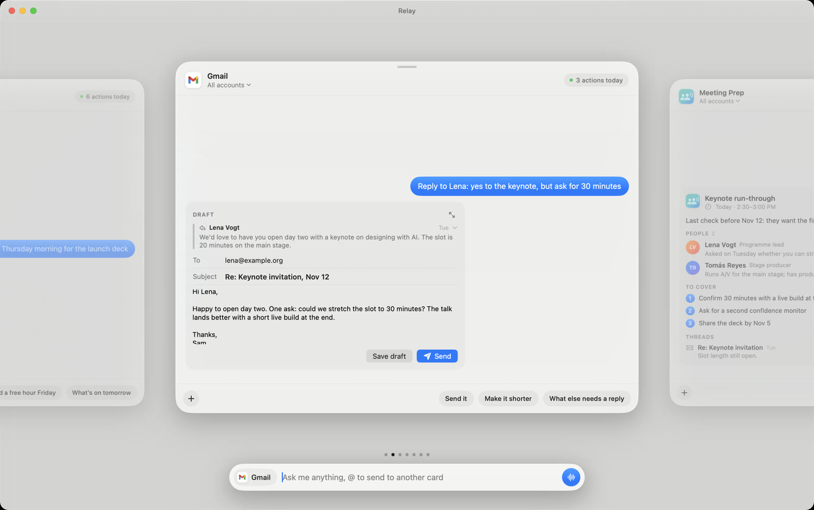
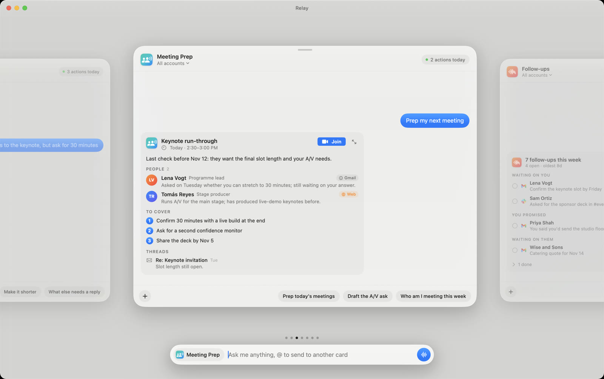
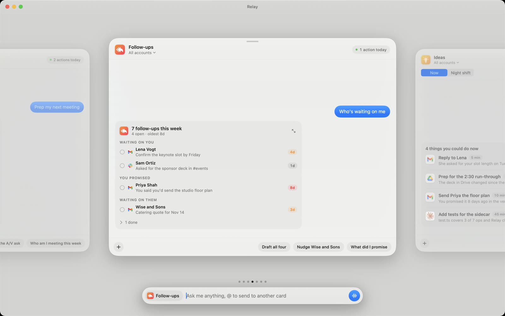
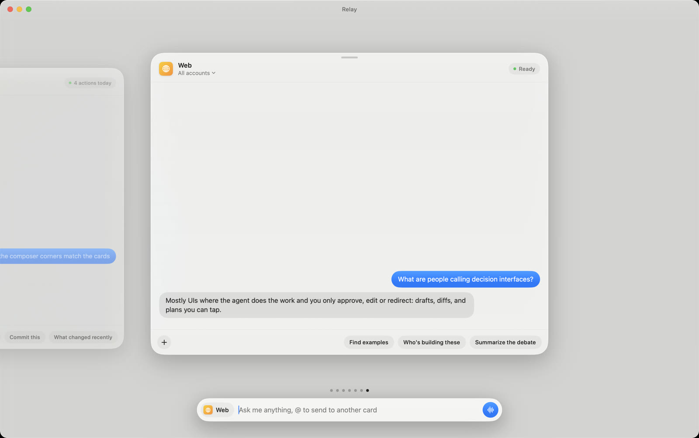

# Open Relay

A decision interface for your agents, as a native Mac app. Every connector (Gmail, Calendar, Slack, Notion, Drive, a code folder) gets its own glass card in a swipeable carousel. One composer at the bottom talks to whichever card is in front. The agent does the work, and the card shows you the result as something you can decide on: a draft with a Send button, a diff to approve, a calendar day, a list of follow-ups with a Do it button on each.

https://github.com/michaelraspuzzi/open-relay/raw/main/docs/relay-tour.mp4

It runs on the `claude` you already have installed and logged in, through the Claude Agent SDK. There's no API key, and each card's conversation is an ordinary Claude Code session you can resume with `claude --resume <id>`.

Inspired by Felix Haas's [multi-agent interface demo](https://x.com/felixhhaas/status/2095202955918008622). Write-up: [Open Relay](https://michaelraspuzzi.github.io/memos/open-relay.html).

| | |
|---|---|
|  |  |
|  |  |

## Requirements

- macOS 26 (Liquid Glass), Xcode 26 / Swift 6.2
- [Claude Code](https://claude.com/claude-code) installed and logged in (`claude` on your PATH)
- [Bun](https://bun.sh) for the sidecar
- Your connectors set up in Claude Code or on claude.ai (Gmail, Calendar, Slack, Notion…). Relay finds them; it doesn't configure them.
- Optional: the [Codex](https://openai.com/codex) CLI signed in to ChatGPT, for the Codex card

## Run it

```bash
git clone https://github.com/michaelraspuzzi/open-relay
cd open-relay/Relay/sidecar && bun install && cd ..
./make-app.sh && open ~/Applications/Relay.app   # the real app: Dock icon, Spotlight, its own mic permission
swift run                                        # quick dev loop
```

Don't export `ANTHROPIC_API_KEY` in the shell that launches Relay: it outranks your claude.ai login.

[`Relay/README.md`](Relay/README.md) has every shortcut and gesture. [`PLAN.md`](PLAN.md) is the original design plan, written frame by frame from the video.

## The cards

| Card | What it does |
|---|---|
| Gmail, Calendar, Slack, Notion, Drive, Excalidraw | One connector each. Pick an account from the subtitle when you have several (say two Notion workspaces). |
| Meeting Prep | Preps your next meeting: attendees from Calendar, history from Gmail, a quick web search only when that's thin. |
| Follow-ups | What you owe people, what you promised, who hasn't answered you. Each one drafts on a click; nothing is sent. |
| Ideas | Three to five things to do now, each with Do it. Night shift queues one-to-five-hour tasks for 11 PM. |
| Discover | Recommends connectors you don't have yet, from evidence in your inbox, calendar and repos. |
| Web | Searches and answers with sources. |
| Claude Code, Codex | Coding agents in a folder you pick, with task lists, diffs and approvals. Parallel cards can each get a git worktree. |
| LinkedIn, Substack | Drafting cards. You post and publish yourself. |
| Memo, CRM | Follow a Claude Code agent file if you have one (`~/.claude/agents/memo.md`, `crm.md`), so Relay and Claude Code share one set of instructions. |

Add or change cards in [`Relay/Sources/Relay/Connectors.swift`](Relay/Sources/Relay/Connectors.swift): a card is a name, a logo, the MCP servers it matches, a system prompt and three starter chips. Rich results come from `show_*` tools the sidecar gives the agent ([`Relay/sidecar/index.ts`](Relay/sidecar/index.ts)), rendered in [`Blocks.swift`](Relay/Sources/Relay/Blocks.swift).

## Safety

- Anything that sends, posts, deletes or declines asks first. Approve with ⌘↩, deny with ⌘⌫.
- Sends wait 8 seconds with an Undo bar (`defaults write org.openrelay.relay relay.undoSeconds 15` to change it).
- The iPhone companion (`RelayMobile/`) talks to the Mac over your local network on port 7788, only after scanning a pairing code that carries a random token stored in `~/Library/Application Support/Relay/remote-token`.

## Layout

- `Relay/`: the Mac app (SwiftUI + AppKit) and `sidecar/`, the Agent SDK bridge (`bun run test.ts` runs the end-to-end checks)
- `RelayMobile/`: an iPhone companion that mirrors your cards. Set your own team in `project.yml` to build it.
- State lives in `~/Library/Application Support/Relay/`. `RELAY_DATA=/some/folder` points a test instance somewhere else.

## License

MIT
